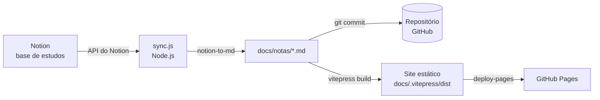

# Studie and Grow

Caderno de estudos automatizado: as anotações são escritas no **Notion** e publicadas como um site de documentação com **VitePress**, gerado e hospedado pelo **GitHub Actions** e pelo **GitHub Pages**.

🌐 **Site publicado:** https://nicolasccampos.github.io/studie-and-grow/

---

## Motivação

Quero registrar meus estudos em um lugar que seja fácil de escrever e fácil de consultar. O Notion é ótimo para escrever, mas não é um lugar de publicação. Este projeto automatiza essa ponte: eu escrevo no Notion, e o site é atualizado com o conteúdo, sem copiar e colar nada manualmente.

---

## Como funciona



- O script `sync.js` consulta a base de dados do Notion pela API oficial.
- Cada página é convertida de blocos do Notion para Markdown com a biblioteca `notion-to-md`.
- Os arquivos são salvos em `docs/notas/`.
- O VitePress gera o site estático a partir de `docs/`.
- O workflow publica o resultado no GitHub Pages.

O workflow roda **manualmente** (botão *Run workflow*) ou **diariamente**, à meia-noite UTC.

---

## Tecnologias

- **Node.js 20**: execução do script de sincronização
- **Notion API**: leitura das páginas da base de estudos
- **notion-to-md**: conversão dos blocos do Notion para Markdown
- **VitePress**: geração do site de documentação
- **GitHub Actions**: automação do fluxo de sincronização, build e deploy
- **GitHub Pages**: hospedagem do site

---

##  Estrutura do projeto

```text
studie-and-grow/
├── .github/
│   └── workflows/
│       └── sync-notion.yml    # Workflow: sincronização, build e deploy
├── docs/
│   ├── .vitepress/
│   │   └── config.mjs         # Configuração do site e menu lateral
│   ├── notas/                 # Páginas geradas a partir do Notion
│   ├── index.md               # Página inicial
│   └── ...
├── .gitignore
├── package.json
└── sync.js                    # Script que lê o Notion e gera os arquivos .md
```

---

##  Configuração

### 1. Criar a integração no Notion

- Acesse [notion.so/my-integrations](https://www.notion.so/my-integrations) e crie uma integração interna.
-  Copie o **Internal Integration Secret**. Ele será o `NOTION_TOKEN`.
- Na página da base de estudos, clique em `...` > **Connect to** e selecione a integração. Sem isso, a API não consegue ler a base.
- O `NOTION_DATABASE_ID` é o código de 32 caracteres que aparece na URL da base, antes de `?v=`.

### 2. Configurar os segredos no GitHub

Em **Settings > Secrets and variables > Actions**, crie:

| Nome | Valor |
|---|---|
| `NOTION_TOKEN` | Token da integração |
| `NOTION_DATABASE_ID` | ID da base de dados |

Em **Settings > Actions > General**, em *Workflow permissions*, marque **Read and write permissions**, para que o workflow consiga fazer commit.

### 3. Ativar o GitHub Pages

Em **Settings > Pages**, em *Build and deployment*, selecione **GitHub Actions** como fonte.

---

##  Como rodar localmente

Pré-requisitos: Node.js 18 ou superior e Git.

```bash
# 1. Clonar o repositório
git clone https://github.com/nicolasccampos/studie-and-grow.git
cd studie-and-grow

# 2. Instalar as dependências
npm install

# 3. Definir as variáveis de ambiente (PowerShell)
$env:NOTION_TOKEN="seu_token"
$env:NOTION_DATABASE_ID="seu_database_id"

# 4. Sincronizar as notas do Notion
node sync.js

# 5. Visualizar o site localmente
npm run docs:dev
```

Para gerar a versão de produção:

```bash
npm run docs:build
```

---

## Publicação

1. Edite as páginas no Notion.
2. Acesse a aba **Actions** do repositório.
3. Clique em **Sincronizar Notion e Deploy do Site** > **Run workflow**.
4. Aguarde o workflow ficar verde e confira o site.

Se houver alterações nas notas, o workflow faz commit automático em `docs/notas/` com a mensagem `docs: atualizando notas do Notion`.

---

## Desafios resolvidos

- **Caminho base do GitHub Pages:** o site fica em `/studie-and-grow/`, então o VitePress precisou da opção `base` configurada. Sem ela, CSS e rotas quebravam.
- **Pasta `node_modules` no Git:** dependências foram enviadas por engano ao repositório. Resolvi com um `.gitignore` na raiz e removendo a pasta do rastreamento com `git rm -r --cached`.
- **Conflitos de merge:** o robô do workflow fazia commits enquanto eu commitava localmente, o que gerou conflitos. Resolvi sincronizando com `git pull` antes de enviar as alterações.
- **Erro na biblioteca do Notion:** a chamada `notion.databases.query` falhou em uma versão da biblioteca. Troquei a consulta por uma chamada direta à API REST com `fetch`, usando a versão `2022-06-28` do cabeçalho `Notion-Version`.
- **Organização do VitePress:** o build só funcionou depois que `.vitepress/` e as páginas foram movidos para dentro de `docs/`, que é a pasta de conteúdo do projeto.

---

## Próximos passos

- [ ] Publicar somente páginas marcadas com uma propriedade "Publicar" no Notion
- [ ] Gerar o menu lateral com categorias a partir das propriedades da base
- [ ] Adicionar testes para a conversão de blocos do Notion
- [ ] Baixar imagens do Notion para o repositório, já que as URLs temporárias expiram

---

## Licença

Projeto pessoal de estudos. Sinta-se à vontade para usar como referência.

---

Desenvolvido por [Nicolas Coimbra](https://github.com/nicolasccampos) 👨‍💻
