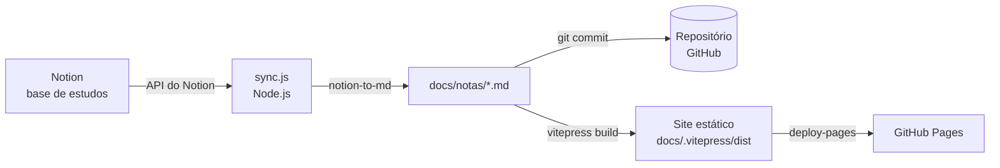

# Studie and Grow

Caderno de estudos automatizado: escrevo as anotações no **Notion** e o conteúdo é publicado como site de documentação com **VitePress**, via **GitHub Actions** e **GitHub Pages**.

🌐 **Site:** https://nicolasccampos.github.io/studie-and-grow/


---

## Motivação

Quero registrar meus estudos em um lugar fácil de escrever e ter a facilidade de consultar todos os meus conteúdos de forma online. O Notion é ótimo para escrever, mas não publica. 

Este projeto faz essa ponte: escrevo no Notion e o site é atualizado sem copiar e colar nada manualmente. Assim alcanço meu objetivo principal, de ter conteúdos só meus publicados na Web para qualquer um ver e estudar.

---

## Como funciona



O workflow roda **manualmente** (*Run workflow*) ou **diariamente**, à meia-noite UTC.

---

## Tecnologias

- **Node.js 20**: execução do script de sincronização e do build no GitHub Actions
- **Notion API**: leitura das páginas da base de estudos
- **notion-to-md**: conversão dos blocos do Notion para Markdown
- **VitePress**: geração do site de documentação
- **GitHub Actions**: sincronização, build e deploy
- **GitHub Pages**: hospedagem

---

## Estrutura do projeto

```text
studie-and-grow/
├── .github/
│   └── workflows/
│       └── sync-notion.yml    # Sincronização, build e deploy
├── docs/
│   ├── .vitepress/
│   │   └── config.mjs         # Configuração do site e menu lateral
│   ├── notas/                 # Páginas geradas a partir do Notion
│   └── index.md               # Página inicial
├── .gitignore
├── package.json
└── sync.js                    # Lê o Notion e gera os arquivos .md
```

---

## Configuração

### 1. Integração no Notion

- Crie uma integração interna em [notion.so/my-integrations](https://www.notion.so/my-integrations).
- Copie o **Internal Integration Secret**. Ele será o `NOTION_TOKEN`.
- Na página da base de estudos, em `...` > **Connect to**, selecione a integração. Sem isso, a API não consegue ler a base.
- O `NOTION_DATABASE_ID` é o código de 32 caracteres na URL da base, antes de `?v=`.

### 2. Segredos no GitHub

Em **Settings > Secrets and variables > Actions**, crie:

| Nome | Valor |
|---|---|
| `NOTION_TOKEN` | Token da integração |
| `NOTION_DATABASE_ID` | ID da base de dados |

Em **Settings > Actions > General**, em *Workflow permissions*, marque **Read and write permissions** para que o workflow consiga fazer commit.

### 3. GitHub Pages

Em **Settings > Pages**, em *Build and deployment*, selecione **GitHub Actions** como fonte.

---

## Como rodar localmente

Pré-requisitos: Node.js 18 ou superior e Git.

```bash
# 1. Clonar o repositório
git clone https://github.com/nicolasccampos/studie-and-grow.git
cd studie-and-grow

# 2. Instalar as dependências
npm install

# 3. Definir as variáveis de ambiente
# PowerShell
$env:NOTION_TOKEN="seu_token"
$env:NOTION_DATABASE_ID="seu_database_id"

# Linux/macOS
export NOTION_TOKEN="seu_token"
export NOTION_DATABASE_ID="seu_database_id"

# 4. Sincronizar as notas
node sync.js

# 5. Visualizar o site
npm run docs:dev
```

Para gerar a versão de produção:

```bash
npm run docs:build
```

---

## Publicação

1. Edite as páginas no Notion.
2. Acesse a aba no Github**Actions** do seu repositório.
3. Clique em **Sincronizar Notion e Deploy do Site** > **Run workflow**.
4. Aguarde o workflow ficar verde e confira o site.

Se houver alterações nas notas, o workflow faz commit automático em `docs/notas/` com a mensagem `docs: atualizando notas do Notion`.

---

## Desafios resolvidos

- **Caminho base do GitHub Pages:** o site fica em `/studie-and-grow/`, então foi preciso configurar a opção `base` do VitePress. Sem ela,o CSS e as rotas quebravam.
- **`node_modules` versionado:** dependências foram enviadas por engano ao repositório. Consegui resolver com um `.gitignore` na raiz e removendo a pasta do rastreamento com `git rm -r --cached`.
- **Conflitos de push:** o workflow fazia commits em `main` enquanto eu enviava alterações locais. Resolvi integrando o remoto com `git pull` e removendo arquivos gerados que não deveriam ser versionados.
- **Erro na biblioteca do Notion:** a chamada `notion.databases.query` falhou em uma versão da biblioteca. Troquei por uma chamada direta à API REST com `fetch`, usando o cabeçalho `Notion-Version: 2022-06-28`.
- **Organização do VitePress:** o build só funcionou depois que `.vitepress/` e as páginas foram movidos para dentro de `docs/`, a pasta de conteúdo do projeto.

---

## Licença

Projeto pessoal de estudos. Sinta-se à vontade para usar como referência.

---

Desenvolvido por [Nicolas Coimbra de Campos](https://github.com/nicolasccampos)
